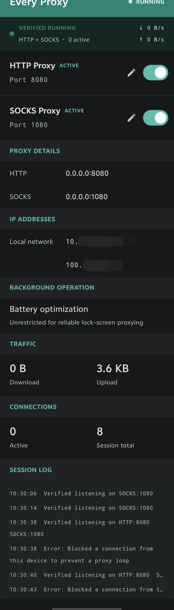

# Bovf Proxy

[English](README.md) | 简体中文

[Android Proxy Server](https://github.com/hect0x7/android-proxy-server) 的个人分支：极简、开源、无广告的 Android HTTP/SOCKS5 代理。由 bovf 修改，增加代理凭据清理、响应背压、独立应用标识及经验证的签名发布。

应用 ID：`io.github.bovf.proxy`（可与上游同时安装，设置相互独立）。保留 Kotlin 命名空间及上游署名。


## 截图（上游界面；本分支标题为 Bovf Proxy）

| 应用 |
|:---:|
|  |

## 功能

- HTTP 代理，默认端口 `8080`
- HTTPS 和 SSH TCP `CONNECT` 隧道转发
- SOCKS5 TCP `CONNECT`，默认端口 `1080`
- HTTP 与 SOCKS5 可独立启停和修改端口
- 监听本机网络接口，供局域网设备连接
- 拒绝来自手机自身的连接，防止递归代理回环
- 使用 Android 当前默认网络出口，包括另一款已连接的 VPN
- 通过用户主动控制的前台服务保持运行
- 报告启动成功前执行本机监听器自检
- 显示常驻健康状态条、实时传输速率和活动连接数
- 显示累计流量统计和仅存于内存的本次会话日志

## 快速开始

让 Android 手机和客户端设备连接同一个可信局域网，在应用中启动 HTTP 和/或 SOCKS5，然后在客户端代理设置中填写手机的局域网 IP 和应用显示的端口。

```text
客户端设备             家用路由器             Android 手机               互联网
192.168.1.x   <---->  同一 Wi-Fi/局域网  <---->  代理服务器  <---->  VPN/默认网络出口
                                                   8080 HTTP
                                                   1080 SOCKS5
```

若要兼容已有的无认证 HTTP 代理辅助工具，请在应用中把 HTTP 端口改为 **3128**，并让辅助工具连接手机显示的局域网地址。用户名和密码留空。默认端口仍为 `8080`，无需修改 shell 或 Nix 配置。

协议选择、配置示例和故障排查参见带图的[新手入门指南](docs/GETTING_STARTED.zh-CN.md)。

## 隐私与安全

应用不包含广告、分析、遥测、崩溃上报、账号、内购、评分提示、远程配置或自动更新 SDK。设置只保存在 Android 私有应用存储中；流量统计和会话日志只保存在内存中，并在服务停止后清除。

代理默认没有身份验证，并监听 `0.0.0.0`。请只在可信网络中启用，不要把代理端口直接暴露到公网。

详情参见[隐私说明](PRIVACY.zh-CN.md)和[安全说明](SECURITY.zh-CN.md)。

## VPN 兼容性

本应用不使用 Android `VpnService`，也不会创建 VPN 网络接口。代理出站连接遵循 Android 当前默认路由，因此可以在另一款 VPN 应用已连接时继续运行，并通过该 VPN 出站。

## 锁屏运行

只要任一代理监听器正在运行，前台服务就会持有部分唤醒锁，使代理在熄屏后仍能继续处理连接。在 Android 6.0 及更高版本中，请在应用的 **Background Operation** 区域点击 **Allow**，允许应用忽略电池优化；否则设备长时间闲置进入 Doze 后，系统可能暂停网络访问。部分厂商设备还需要在系统设置中开启“不受限制”的电池使用、允许后台活动或允许自启动。

## 构建与发布

`master` 和 PR CI 会运行单元测试并构建临时 Debug APK，不接收签名密钥。发布前先在本地验证，然后将已完成的默认分支和带注释的版本标签以 **一次原子推送** 提交；不进行提前测试推送。

```sh
# 验证通过并提交所有发布修改后：
git tag -a v1.1.3 -m "Bovf Proxy v1.1.3"
git push --atomic origin HEAD:refs/heads/master refs/tags/v1.1.3
```

标签工作流测试该标签对应的精确提交，使用本分支专用密钥签名，核对固定证书摘要、应用 ID、版本及内嵌源代码提交号，然后为最终 APK 生成 GitHub 来源证明并验证后再发布。Release 包含签名 APK 和 SHA-256 校验文件；绝不覆盖已有附件。来源证明标识工作流和源代码，并不等同于独立复现构建。

签名密钥备份、安全设置 Secrets 和下载验证参见[发布说明](docs/RELEASING.zh-CN.md)；另见 [1.1.3 更新说明](docs/releases/1.1.3.zh-CN.md)。

本地测试与构建（未设置签名环境变量时，Release 不带签名）：

```sh
bash ./gradlew :proxycore:testDebugUnitTest :app:testDebugUnitTest :app:assembleDebug :app:assembleRelease
```

项目包含两个模块：

- `app`：Compose 界面和 Android 前台服务
- `proxycore`：HTTP、HTTPS `CONNECT` 和 SOCKS5 TCP 转发

代理核心不依赖 Android `VpnService`。

## 限制

- SOCKS5 仅支持无认证 TCP `CONNECT`
- 不支持 SOCKS5 `UDP ASSOCIATE` 或 `BIND`
- 不支持 HTTP/SOCKS5 用户名密码认证
- 真机、熄屏/Doze、热点及并行 VPN 行为需要设备实测；本地套接字测试不能证明这些行为
- 启动自检仅确认本地监听器接受连接，不代表互联网或 VPN 可达

## 许可证

Copyright 2026 hect0x7。项目采用 Apache License 2.0，参见 [LICENSE](LICENSE) 和 [NOTICE](NOTICE)。
